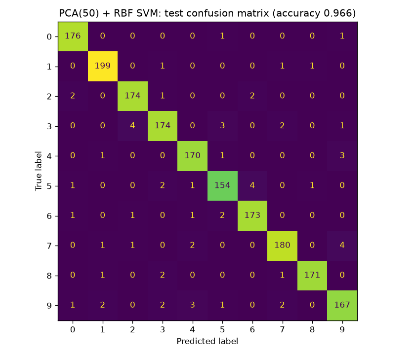

# Data Science Case Studies

[](https://github.com/divyam1101/Data-Science/actions/workflows/tests.yml)

Seven end-to-end business case studies: classification, regression, credit-risk scoring, time-series forecasting and exploratory analysis. Each study answers a business question and is a small, tested Python module.

> **2026 update:** I wrote these in R in 2018. They are now ported to Python, with the methodological problems I found in the originals fixed (see *What changed*). The original R scripts are kept in [`legacy_r/`](legacy_r) for comparison.

| Case study | Business question | Methods | Module |
|---|---|---|---|
| **Employee attrition** | ~15% of staff leave each year. Who is at risk, and why? | Logistic regression (CV-regularised) vs gradient boosting, ROC-AUC / PR-AUC, threshold from out-of-fold predictions, KS, gain/lift, odds ratios | [`hr_attrition.py`](src/case_studies/hr_attrition.py) |
| **Car price drivers** | Which attributes set a car's price in the US market? | Log-price regression, LassoCV feature selection, OLS + VIF for interpretation, gradient boosting, repeated k-fold CV | [`car_price.py`](src/case_studies/car_price.py) |
| **Handwritten digits** | Classify digits from 28×28 pixel images | Linear SVM vs PCA + RBF SVM, grid search with stratified CV, confusion matrix | [`digit_recognition.py`](src/case_studies/digit_recognition.py) |
| **Credit risk (Lending Club)** | Which applicant attributes predict loan default? | Default rates with Wilson CIs, information value / weight of evidence, logistic scorecard with an out-of-time test | [`credit_risk.py`](src/case_studies/credit_risk.py) |
| **Investment strategy** | Which funding type, countries and sectors should a fund target? | Robust (median) round sizes, country ranking, sector mapping, pandas pipeline | [`investment.py`](src/case_studies/investment.py) |
| **Uber supply-demand gap** | When and where do cab requests go unfulfilled? | Mixed-format timestamp parsing, time-slot segmentation, gap quantification, heatmaps | [`uber_supply_demand.py`](src/case_studies/uber_supply_demand.py) |
| **Bitcoin forecasting** | Can ARIMA forecast the price better than "tomorrow = today"? | Walk-forward evaluation, AIC-selected ARIMA on log prices vs naive and drift baselines | [`bitcoin_forecast.py`](src/case_studies/bitcoin_forecast.py) |

## Results

### Handwritten digit recognition (run on the included 9,000-image MNIST sample)

Stratified 80/20 split (7,200 train / 1,800 test); hyperparameters chosen by 5-fold CV on the training set.

| Model | CV accuracy | Test accuracy | Test macro-F1 |
|---|---|---|---|
| Linear SVM (C = 0.01) | 0.899 | 0.896 | 0.894 |
| **PCA(50) + RBF SVM** (C = 5, γ = 0.05) | **0.966** | **0.966** | **0.965** |

The kernel SVM cuts the error rate by two-thirds (10.4% → 3.4%). The most confused digits are 9, 5 and 3 (F1 0.94-0.95). Full per-class report: [`reports/digit_recognition/`](reports/digit_recognition).



The other six studies need third-party datasets that aren't stored in this repo (see [`data/README.md`](data/README.md)). Their code is tested end to end on synthetic data with the same schema, and each produces its metrics, tables and charts in `outputs/<study>/` when run on the real data. The 2018 deliverables are kept in [`reports/`](reports).

## What changed in the 2026 rewrite

| Study | Problem in the 2018 version | Fix |
|---|---|---|
| Car price | Final model was fitted on the **full dataset**, then scored on a test set it had already seen | Test set held out from every step, including feature selection |
| Car price | 30 hand-edited `lm()` calls removing one variable at a time | LassoCV in a pipeline, then OLS + VIF on the selected features for interpretation |
| HR attrition | Outlier removal, row deletion and scaling done **before** the train/test split | Imputation and scaling inside a pipeline fitted on training folds only; no rows dropped |
| HR attrition | Probability cutoff tuned **on the test set**; the cutoff-sweep function had a bug that always used the 0.40 predictions | Cutoff chosen with Youden's J on out-of-fold training predictions |
| HR attrition | KS statistic computed on 0/1 labels | KS, ROC-AUC, average precision and Brier score computed on probabilities |
| Digits | RBF SVM trained on raw 0-255 pixels (`scale = FALSE`) | Pixels scaled to [0, 1]; PCA before the RBF kernel |
| Credit risk | Default rates included loans still "Current"; charts only, no quantified ranking | Completed loans only, application-time fields only, Wilson CIs, information-value ranking, out-of-time scorecard |
| Investment | Missing round sizes **filled with the mean** before averaging by funding type | Missing amounts excluded; skewed sizes judged by the median |
| Uber | Hour strings compared with numbers to build time slots; three coarse slots | Numeric hours; five documented slots; gap and main failure mode quantified |
| Bitcoin | One MAPE number on 3-4 points, with no baseline | Walk-forward evaluation against naive and drift forecasts |

## Run it

```bash
python -m venv .venv && source .venv/bin/activate      # Windows: .venv\Scripts\activate
pip install -e ".[dev]"
pytest -q                                               # 16 tests, synthetic data, ~3 minutes
python -m case_studies.digit_recognition                # runs on the included MNIST sample
python -m case_studies.car_price --data data/car_price/CarPrice_Assignment.csv
```

Each module's docstring explains its methodology in more detail. `python -m case_studies.<module> --help` lists its options.
